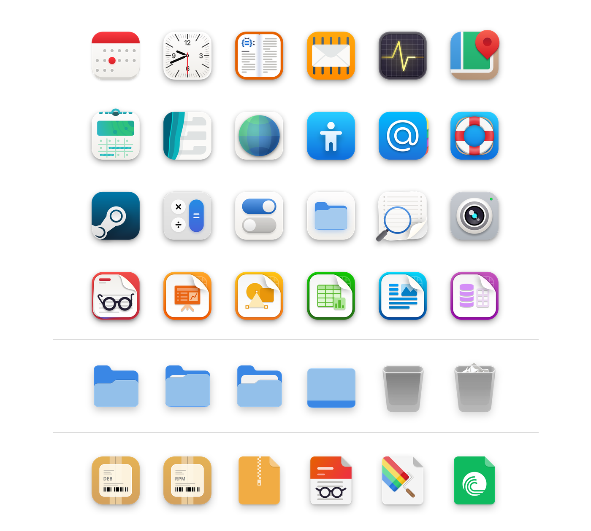
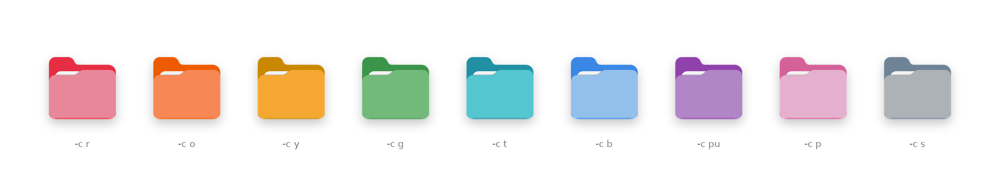
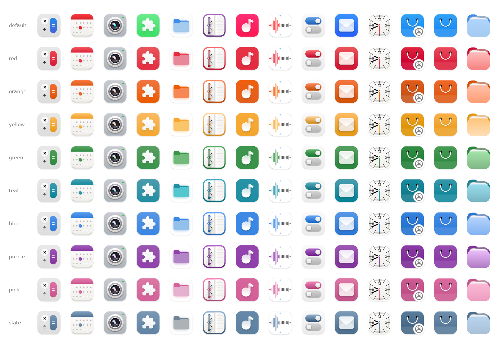
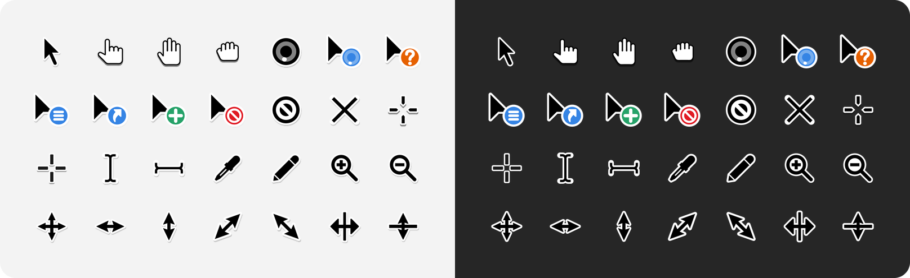

<h1>Adwair</h1>

A refined icon theme blending the polished look of WhiteSur with the clean, native feel of Adwaita.

<br clear="left">



## Installation

### Automatic installation

Clone the repository and run the installer:

```bash
git clone --depth 1 https://github.com/kusaida/Adwair.git
cd Adwair
chmod +x install.sh
./install.sh
```

Two themes are installed:

```text
~/.local/share/icons/Adwair       # light app icons
~/.local/share/icons/Adwair-dark  # dark app icons, inherits Adwair
```

### Manual installation

Download the archive from the [Releases](https://github.com/kusaida/Adwair/releases) page, extract it and place the contents in `~/.local/share/icons`

### Selecting the theme

Select **Adwair** (or **Adwair-dark** for dark app icons) in **Refine** or **GNOME Tweaks**, or from the terminal:

```bash
gsettings set org.gnome.desktop.interface icon-theme 'Adwair'
gsettings set org.gnome.desktop.interface cursor-theme 'Adwair'
```

## Installation options

| Option | Description |
|:-------|:------------|
| `-c`, `--color [COLOR]` | Use a colored folder variant (default: `blue`); accepts a case-insensitive name or unambiguous prefix, e.g. `b`, `pu` or `s` |
| `-a`, `--apps` | Also install colored app icons, including the dark variants (requires `-c`) |
| `-n`, `--name NAME` | Theme name (default: `Adwair`); the dark variant is installed as `NAME-dark` |
| `-p`, `--path PATH` | Installation directory (default: `$HOME/.local/share/icons`) |
| `-f`, `--folder-icons` | Assign folder icons by name after install (requires `gio`) |
| `-r`, `--remove`, `-u`, `--uninstall` | Uninstall the theme and its dark variant |
| `-F`, `--folder-name` | Only with `-r`/`-u`: also reset the folder icons set by `-f` |
| `-d`, `--dry-run` | Preview what would be created, copied or removed without changing anything |
| `-h`, `--help` | Show help |

Available colors: `blue`, `green`, `orange`, `pink`, `purple`, `red`, `slate`, `teal`, `yellow`.

### Colored folders

```bash
./install.sh -c COLOR
```



### Colored app icons

```bash
./install.sh -c COLOR -a
```

This also installs the matching accent-colored icons for the dark app icon
theme (`Adwair-dark`), so the dark variant uses the same accent color.



## Updating

To update an existing installation, pull the latest changes and run the installer again with the same options you used originally:

```bash
git pull
./install.sh -c COLOR -a
```

On update, files and symlinks that no longer exist in `src/` or `links/` are removed from the installed theme, and empty directories are cleaned up. This keeps the installed theme in sync with the repository, but it also means icons removed upstream will disappear locally.

To preview what an install, update or uninstall would do without modifying anything, add `-d` / `--dry-run`:

```bash
./install.sh -c COLOR -a -d
```

## Cursor theme

A modernized Adwaita cursor theme with HiDPI support. It is already included and installed with the icon theme, just select **Adwair** as the cursor theme in **Refine** or **GNOME Tweaks**, the same way as the icon theme.



<details>
<summary>Animated cursors</summary>


</details>

## Custom folders

The `-f` / `--folder-icons` option assigns themed icons to your folders after installation, so you don't have to change them one by one.

For example:

- `github` → `folder-github`
- `games` → `folder-games`
- `projects` → `folder-projects`

```bash
# Teal folders with a custom theme name and run the folder generator
./install.sh -c t -n MyIcons -f
```

## Uninstall

```bash
./install.sh -r        # remove the theme and its -dark variant
./install.sh -r -F     # also reset the folder icons set by -f
./install.sh -r -d     # preview what would be removed
```

If you installed with a custom name or path, pass the same `-n` / `-p` values. Note that `-F` resets all non-standard `folder-*` icons, including ones you may have set by hand. `-d` / `--dry-run` only reports what would happen, so folder icons are left untouched.

## Credits

Adwair is a derivative work based on and incorporating modified artwork from the following projects:

- [WhiteSur Icon Theme](https://github.com/vinceliuice/WhiteSur-icon-theme) by vinceliuice — GPL-3.0
- [Hatter](https://github.com/Mibea/Hatter) by Mibea — GPL-3.0
- [MoreWaita](https://github.com/somepaulo/MoreWaita) by somepaulo — GPL-3.0
- [Adwaita Icon Theme](https://gitlab.gnome.org/GNOME/adwaita-icon-theme) by the [GNOME Project](https://www.gnome.org) — LGPL-3.0

## License

Adwair is licensed under the [GPL-3.0](LICENSE).
