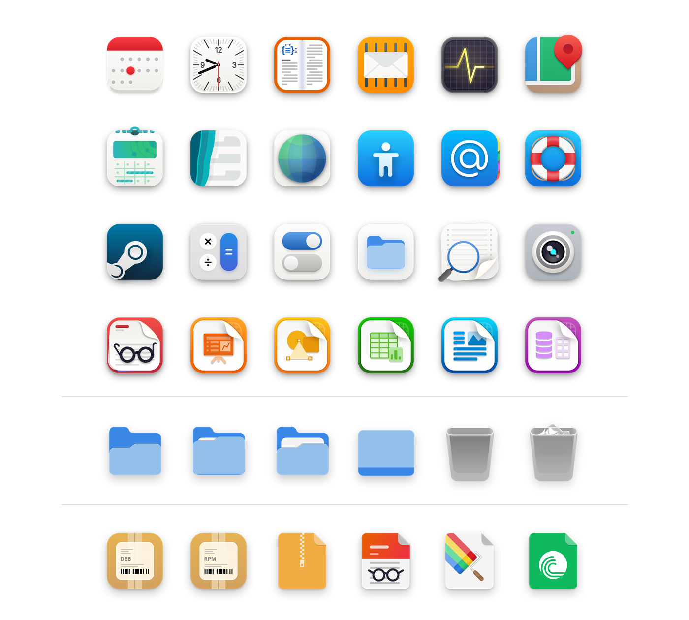
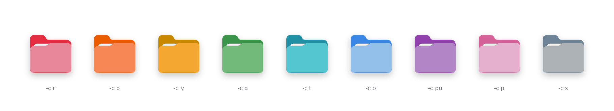
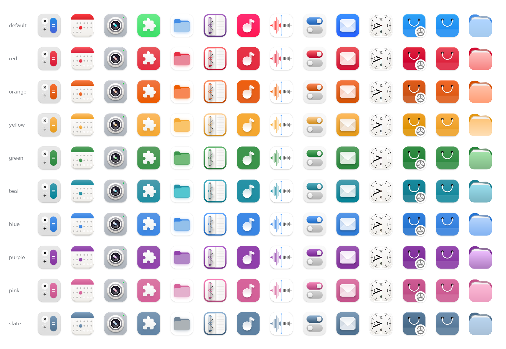
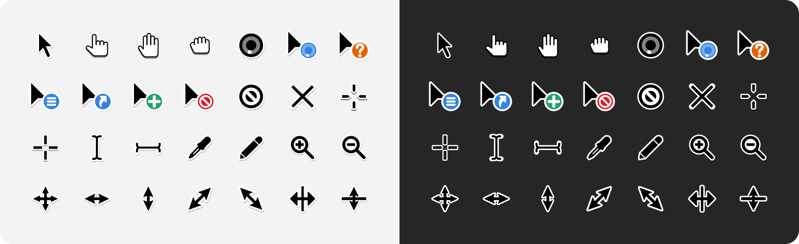

# Adwair

A refined icon theme blending the polished look of WhiteSur with the clean, native feel of Adwaita.



## Installation

### Automatic installation

Clone the repository and run the installer:

```bash
git clone --depth 1 https://github.com/kusaida/Adwair.git
cd Adwair
chmod +x install.sh
./install.sh
```

Two themes are installed:

```text
~/.local/share/icons/Adwair       # light app icons
~/.local/share/icons/Adwair-dark  # dark app icons, inherits Adwair
```

### Manual installation

Download the archive from the [Releases](https://github.com/kusaida/Adwair/releases) page, extract it and place the contents in `~/.local/share/icons`

### Selecting the theme

Select **Adwair** (or **Adwair-dark** for dark app icons) in **Refine** or **GNOME Tweaks**, or from the terminal:

```bash
gsettings set org.gnome.desktop.interface icon-theme 'Adwair'
gsettings set org.gnome.desktop.interface cursor-theme 'Adwair'
```

## Installation options

| Option | Description |
|:-------|:------------|
| `-c`, `--color [COLOR]` | Use a colored folder variant (default: `blue`) |
| `-a`, `--apps` | Also install colored app icons (requires `-c`) |
| `-n`, `--name NAME` | Theme name (default: `Adwair`); the dark variant is installed as `NAME-dark` |
| `-p`, `--path PATH` | Installation directory (default: `$HOME/.local/share/icons`) |
| `-f`, `--folder-icons` | Assign folder icons by name after install (requires `gio`) |
| `-r`, `--remove`, `-u`, `--uninstall` | Uninstall the theme and its dark variant |
| `-F`, `--folder-name` | Only with `-r`/`-u`: also reset the folder icons set by `-f` |
| `-h`, `--help` | Show help |

### Colored folders

```bash
./install.sh -c COLOR
```



### Colored app icons

```bash
./install.sh -c COLOR -a
```



## Cursor theme

A modernized Adwaita cursor theme with HiDPI support. It is already included and installed with the icon theme, just select **Adwair** as the cursor theme in **Refine** or **GNOME Tweaks**, the same way as the icon theme.



<details>
<summary>Animated cursors</summary>


</details>

## Custom folders

The `-f` / `--folder-icons` option assigns themed icons to your folders after installation, so you don't have to change them one by one.

For example:

- `github` → `folder-github`
- `games` → `folder-games`
- `projects` → `folder-projects`

```bash
# Teal folders with a custom theme name and run the folder generator
./install.sh -c t -n MyIcons -f
```

## Uninstall

```bash
./install.sh -r          # remove the theme and its -dark variant
./install.sh -r -F       # also reset the folder icons set by -f
```

If you installed with a custom name or path, pass the same `-n` / `-p` values. Note that `-F` resets all non-standard `folder-*` icons, including ones you may have set by hand.

## Credits

Adwair is a derivative work based on and incorporating modified artwork from the following projects:

- [WhiteSur Icon Theme](https://github.com/vinceliuice/WhiteSur-icon-theme) by vinceliuice — GPL-3.0
- [Hatter](https://github.com/Mibea/Hatter) by Mibea — GPL-3.0
- [MoreWaita](https://github.com/somepaulo/MoreWaita) by somepaulo — GPL-3.0
- [Adwaita Icon Theme](https://gitlab.gnome.org/GNOME/adwaita-icon-theme) by the [GNOME Project](https://www.gnome.org) — LGPL-3.0

## License

Adwair is licensed under the [GPL-3.0](LICENSE).
